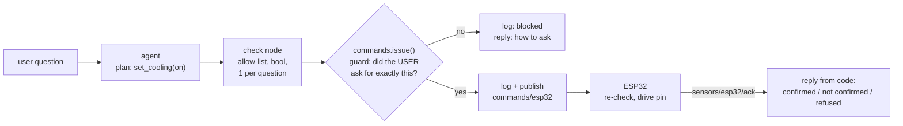

# ADR 0012: Command and control: agent → MQTT → ESP32 actuator

- **Status:** Accepted
- **Date:** 2026-11-09
- **Extends:** [ADR 0011](0011-langgraph-agent.md) (the agent; this adds its
  first tool that changes the physical world) and the MQTT sensor-ingest ADR
  on Ben's `feat/esp_mqtt` branch (numbered 0010 there; the local Mosquitto
  broker on the Pi hotspot `PiNet` that the ESP32 already publishes to).

## Context

Until now every arrow pointed up: sensors → SQLite → cloud, and the assistant
only read. The next goal is the other direction: the agent tells the ESP32 to
switch an actuator (a relay; the onboard LED for the demo), e.g. "turn the
fan on". Reading data wrong gives a wrong sentence. Writing wrong flips a
real relay, so the question for this ADR is **where the safety boundary is,
and what it trusts**.

## Options considered

| Option | Summary | Verdict |
|---|---|---|
| **A. Trust the model** | The prompt says "only switch when asked"; the agent publishes whatever it calls | Rejected. A 2B model follows rules unreliably (ADR 0005 measured it ignoring them), and retrieved text can carry injected instructions. |
| **B. Guard in the agent's `check` node** | Validate before `act` | Rejected *as the only guard*: any other caller (a script, the router later) could publish unguarded. |
| **C. Guard next to the publish** | One function, `commands.issue()`, is the only way to publish; it always guards and logs first | **Chosen.** No caller can skip it. The agent's `check` node still validates shape (allow-list, `on` is a bool, one command per question). |

For the transport: **plain MQTT to the local Mosquitto broker**, not AWS IoT.
The ESP32 is already on the hotspot broker (no certs on the board), and the
command must work when the internet is down. `AWSPublisher` is TLS/IoT-Core
specific, so `CommandPublisher` reuses its *patterns* (paho VERSION2
callbacks, `loop_start`, QoS 1, ack tracking) rather than the class.

## Decision

1. **Topics.** Commands go to `commands/esp32` as
   `{"command_id", "actuator", "state", "ts", "source": "agent"}`. The ESP32
   acknowledges on `sensors/esp32/ack` with `{"command_id", "ok", "cooling_on",
   "error"?}`. The ack topic is two levels deep, so the bridge's `sensors/+`
   doesn't ingest acks as readings. Both QoS 1.
2. **One tool, `set_cooling(on: bool)`.** It is specific rather than a
   generic `command(actuator, state)`, so the schema is itself an allow-list
   and a 2B model has nothing to misspell. Internally it maps to the generic
   `ACTUATORS = {"cooling": {"on", "off"}}`, so another actuator is one entry
   there plus one tool.
3. **The guard (`commands.check`) allows a command only if:**
   - the actuator and state are on the allow-list, **and**
   - **the user's own question explicitly asks for it**: it names the
     actuator ("cooling", "fan", "AC"), asks for exactly that state ("turn …
     on", "switch off", "stop"), and isn't advice, how-to, negation or a
     condition ("should I…", "how do I…", "don't…", "…if it gets hot").
   The model can *propose* a command; only the user's words *authorize* it.
   Doc passages and sensor payloads are never checked for authorization, so
   injected text can't authorize anything, however it's phrased. The check is
   deliberately conservative: when unsure it blocks, and the reply says how
   to ask explicitly ("turn the cooling on").
4. **No autonomous control.** "It's hot in here" gets a reading and a
   recommendation, not a relay click. Closing the loop automatically (a
   thermostat) would be a separate decision with its own limits.
5. **One command per question**, enforced in the agent's `check` node.
6. **Observability.** Every attempt, **blocked or sent**, is appended to
   `logs/commands.jsonl` (gitignored) with the question, the command, the
   outcome, and the reason if blocked.
7. **Code states what happened, never the model.** `commands.describe()`
   writes the sentence: "confirmed by the ESP32", "sent, but it didn't
   confirm within 3 s", "the ESP32 refused…", or "I didn't send a command
   (…)". The model phrases only the data parts of an answer.
8. **Defense in depth on the device** (`ESP/esp32_mqtt/esp32_mqtt.ino`): the
   sketch re-checks the same allow-list and acks refusals, boots with the
   actuator off, and switches itself off after `MAX_ON_MS` (10 min) if no
   "off" arrives (Pi crash, WiFi drop).

## Consequences

- **The open broker is the weak point.** Mosquitto runs `allow_anonymous` on
  the closed hotspot (the sensor-ingest ADR), so any device on `PiNet` can
  publish to `commands/esp32` directly and skip the agent's guard. The
  device-side allow-list and failsafe limit the damage. Anything beyond the
  demo network needs broker auth and an ACL that lets only the
  `agent-commands` client publish to `commands/#`.
- **The keyword guard has false negatives by design** (e.g. "could the fan
  go on?" is blocked). Safe, but users must phrase commands plainly; the
  decline says how.
- **Ack ≠ effect.** "Confirmed" means the ESP32 set the pin, not that the room
  cooled. The reading payload now carries `cooling_on`, so the state is
  logged in `readings` alongside temperature.
- **Commands are not stored in SQLite.** The agent process opens the DB
  read-only (ADR 0003), so the log is a separate append-only file and isn't
  uploaded to AWS. Uploading command history would be a new forwarder
  stream, if needed.
- The sketch lives at Ben's path (`ESP/esp32_mqtt/`) and extends his
  publisher unchanged except for the added `cooling_on` field. When
  `feat/esp_mqtt` is rebased onto the package layout, take this version.
